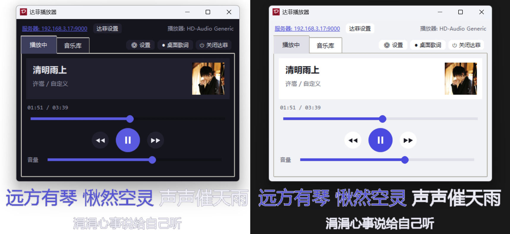
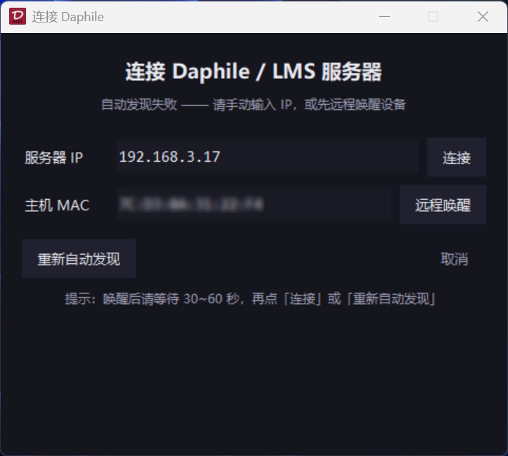

本项目以[智谱清言](https://chatglm.cn/)编写的代码为基础，[DeepSeek](https://www.deepseek.com/)完善而成，编程语言为Python，代码全部开源，并提供exe可执行单文件。软件能够自动扫描达菲服务器地址，音乐库可以通过歌手选择所属专辑，双击歌曲播放。桌面歌词随歌唱进度高亮滚动，PIL + alpha 二值化，使歌词在浅色背景下也能有较好的显示效果，字体及高亮描边颜色均可自定义。

   

   
支持达菲设备远程关机、手动输入IP连接和远程唤醒（首次连接成功后，自动记住达菲设备MAC地址）

   

   
本项目需要达菲安装 <a href="https://github.com/CDrummond/lms-material">Material Skin</a> 和 Music and Artist Information 插件
